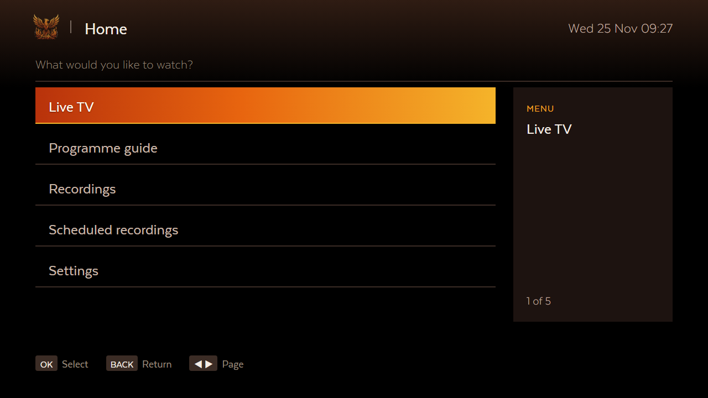
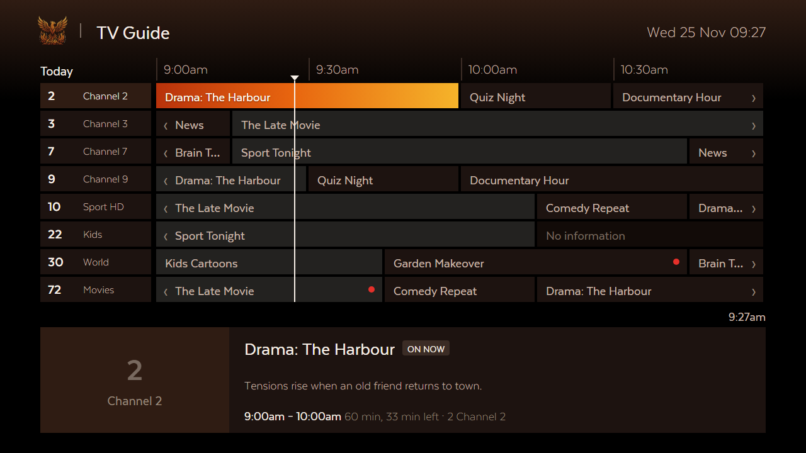
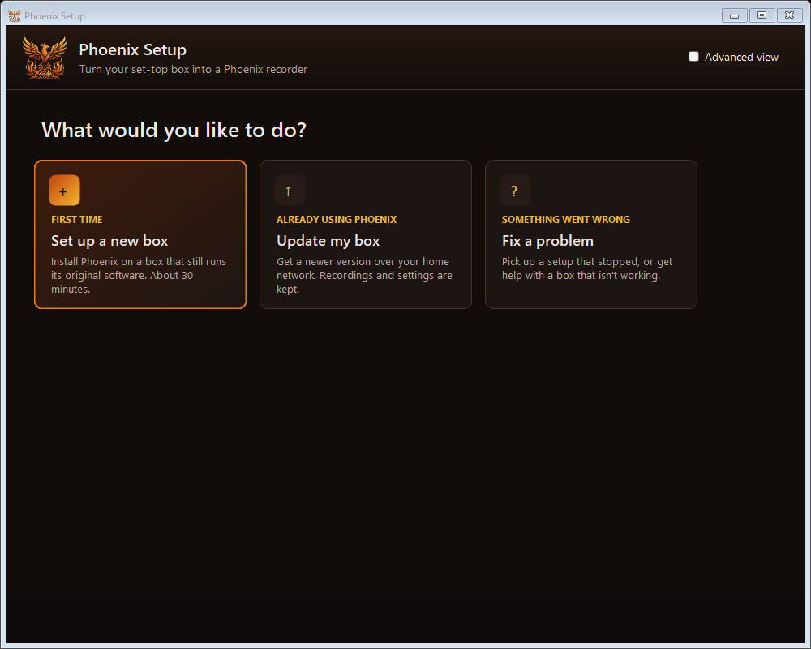

# Phoenix DVR

Phoenix turns a set-top box with a built-in hard drive back into a working TV
recorder. Plug in an antenna, and you get live TV you can pause, a programme
guide, and recordings you can watch, skip through and pick up where you left off.
It runs entirely on the box in your living room, and can run entirely off-line if you so choose.

## Screenshots

| Programme guide | Windows installer |
|---|---|
|  |  |

*Channel names and programmes in these screenshots are sample data.*

## What you can do with it

**Watch live TV, and pause it.** Live TV keeps a rolling four-hour buffer on the
hard drive. You can pause, rewind and fast-forward within that window, and catch
back up to live whenever you like. One of the box's four tuners is set aside just
for live TV, so watching never gets in the way of a recording.

**Record programmes.** Pick a show in the guide and choose *Schedule this
programme*. Up to three channels can record at once, using the box's other three
tuners. Shows that are still recording appear at the top of the Recordings list
marked *RECORDING NOW*, and you can start watching them before they finish.

**Play back with proper controls.** Recordings support fast-forward, rewind,
skipping, pausing and scrubbing along a progress bar. If you stop part-way
through, Phoenix remembers the spot and offers *Resume* or *Start from beginning*
next time.

**Browse the guide.** The programme guide is a grid of channels against time, two
hours at a glance, and it scrolls about a week ahead. EPG Guide information
normally comes from the over-the-air TV signal itself, you can also supplement or replace with an XML feed via the Settings page.

**Find channels automatically.** On first start, Phoenix searches the airwaves for
the channels in your area. Nothing is preset, so it works wherever you are.

**Watch on your computer.** Your recordings and live channels can also be watched on a
PC using software such as [tvhplayer](https://github.com/mfat/tvhplayer) or on a mobile device using [tvhclient](http://tvhclient.com/)

**Look the part.** The menus use Phoenix's own "Molten" design: a phoenix emblem
and warm ember-to-gold colours.

## How it works

Phoenix is built around the open-source [Broadcom stblinux](https://github.com/Broadcom/stblinux) and [Tvheadend](https://tvheadend.org/) projects and has the following features:

- **The tuner manager** (part of Phoenix) controls the box's four TV tuners. It
  searches for channels, then hands three of the tuners to Tvheadend and keeps
  the fourth for live TV.
- **Tvheadend** does the "TV server" work behind the scenes: it keeps the channel
  list, gathers the programme guide, and runs scheduled recordings, saving them to
  the hard drive. It is also what lets other devices on your network, such as a PC
  running tvhplayer, watch the box.
- **The Phoenix menu and player** are what you see on the TV. The menu asks
  Tvheadend for channels, guide listings and recordings, and the player shows them
  on screen.

Your settings, recordings and guide choices live on the box's hard drive, separate
from the Phoenix software itself, so updating Phoenix leaves them in place.  
You can ignore the front-end entirely and just use Tvheadend to remotely manage, stream and schedule any show or live channel.
If you decide you want to go back to what you had previously on the DVR, just remove the USB key and it'll reboot back to it's old self.

## Setting up a box

Boxes are set up from a Windows PC with **PhoenixSetup**, the Windows installer.
You'll need a spare USB stick, that will stay with the DVR, an ethernet cable and your STB's remote.
